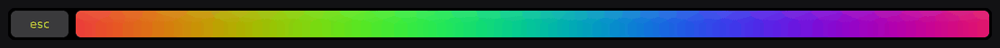

# Touch Bar Rainbow 🌈

A calm, flowing rainbow on your MacBook Pro Touch Bar whenever **PyCharm** is the active app.
Switch to any other app and your normal Touch Bar comes straight back.



* Shows automatically for PyCharm Professional, Community and EAP builds
  (any bundle id starting with `com.jetbrains.pycharm`).
* Smooth, seamless loop with a vivid "sinebow" palette that is easier on the eyes than a plain HSV rainbow.
* GPU-animated with Core Animation: practically zero CPU.
* Keeps an `esc` key on the left, because you need it.
* Lives in the menu bar: choose *Only in PyCharm / Always / Off*, speed, esc key, launch at login.

## Requirements

* A MacBook Pro with a Touch Bar
* macOS 11 Big Sur or later
* Xcode or the Xcode Command Line Tools (`xcode-select --install`) to build

## Install

```sh
git clone https://github.com/nilouabdi/touchbar-rainbow.git
cd touchbar-rainbow
make install        # builds build/TouchBarRainbow.app, copies it to /Applications and starts it
```

Open PyCharm and the rainbow appears. A 🌈 icon in the menu bar holds the settings.

The first time you tap the rainbow bar's `esc` key, macOS asks for **Accessibility** permission
(System Settings → Privacy & Security → Accessibility). It is needed to send the Escape key to PyCharm.
If you don't want that, turn off *Show esc Key* in the menu.

Because the app is ad-hoc signed and not notarised, macOS may block it the first time it opens. If it does,
right-click the app in /Applications and choose **Open**.

## Settings

Everything is in the menu-bar menu. You can also use `defaults`, for example to show the rainbow in other apps:

```sh
defaults write com.nilouabdi.TouchBarRainbow extraBundleIDs -array com.jetbrains.intellij com.jetbrains.goland
defaults write com.nilouabdi.TouchBarRainbow brightness -float 0.8   # 0.2 – 1.0
```

Restart the app after changing `defaults` by hand.

## How it works

Apps cannot draw into another app's Touch Bar, and PyCharm has no plugin hook for custom Touch Bar views.
Touch Bar Rainbow is a small menu-bar app that watches which app is frontmost. When PyCharm is active it uses
macOS's (private, long-stable) *system-modal Touch Bar* API, the same one used by MTMR and Pock, to place its own
Touch Bar on top. All private calls are availability-checked, so on a Mac without that API the app simply does nothing.

See [docs/PLAN.md](docs/PLAN.md) and [docs/DESIGN.md](docs/DESIGN.md) for the full plan and design rationale.

## Development

```sh
swift build          # builds everything (the app target only on macOS)
make test            # unit + visual quality tests (the core also runs on Linux)
make preview         # renders docs/preview.png and docs/preview.gif (needs: pip3 install pillow)
make run             # builds the .app and opens it from build/
```

The visual tests check, numerically, that the animation loops without a seam, has no visible banding
between neighbouring pixels, keeps brightness balanced, covers the full hue circle, stays vivid and moves at a
calm speed. Set `RAINBOW_SNAPSHOT_DIR=/some/dir` when running `swift test` to also write snapshot images.

| Path | What |
| --- | --- |
| `Sources/RainbowCore` | Palette, gradient maths, frame renderer, PyCharm detection, settings (pure Swift) |
| `Sources/TouchBarRainbow` | The AppKit menu-bar app and the Core Animation rainbow view |
| `Sources/TouchBarPrivate` | Objective-C shim around the private Touch Bar API |
| `Sources/rainbow-preview` | CLI that renders preview frames |
| `Tests/RainbowCoreTests` | Unit and visual tests |

## License

Copyright © 2026 nilouabdi

This program is free software: you can redistribute it and/or modify it under the terms of the
GNU General Public License as published by the Free Software Foundation, either version 3 of the License,
or (at your option) any later version. See [LICENSE](LICENSE).
